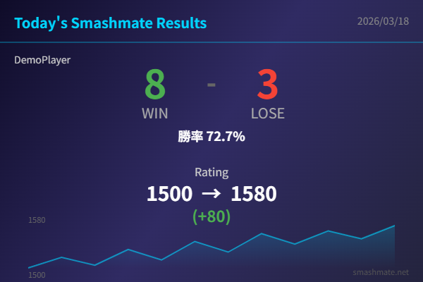

# SmashMateCard

**Version: 1.2.0**

スマメイト(smashmate.net)の計測開始以降のレーティング対戦戦績をカード画像にして、X(Twitter)に共有できるChrome拡張機能です。

> **注意**: 本ツールはsmashmate.netの非公式ツールです。

## スクリーンショット



## 機能

- 対戦IDを基準に、計測開始以降の勝敗数・勝率を自動集計
- 基準IDの自動保存・手動変更（ユーザー・シーズン・日本時間の日付ごとに管理）
- レート変動（開始 → 終了）をグラフ付きで表示
- 戦績カード画像を自動生成
- 画像のコピー・ダウンロード・X(Twitter)への共有
- 4種類のカードテーマ（Dark / Ocean / Crimson / Light）
- 戦績テキストのクリップボードコピー
- デモモード（対戦データがなくても動作確認可能）

## インストール方法

### 1. ダウンロード
1. [こちらのページ](https://github.com/jun-suzuki1028/SmashMateCard) にアクセス
2. 緑色の「Code」ボタンをクリック
3. 「Download ZIP」をクリック
4. ダウンロードしたZIPファイルを右クリック →「すべて展開」で解凍

### 2. Chromeに追加
1. Chromeのアドレスバーに `chrome://extensions` と入力してEnter
2. 画面右上の「デベロッパーモード」をONにする
3. 「パッケージ化されていない拡張機能を読み込む」ボタンをクリック
4. 先ほど解凍したフォルダ（`SmashMateCard-main`）を選択して「フォルダーの選択」をクリック
5. ツールバーにSmashMateCardのアイコンが表示されたら完了

## 使い方

1. smashmate.net にログイン
2. 対戦を始める前に、マイページを開く
3. ツールバーの SmashMateCard アイコンをクリック。その日の初回は最新の終了済み対戦IDが基準として保存され、0勝0敗から計測を開始します
4. 対戦後にもう一度開くか「更新」を押すと、保存したIDより後の勝敗を集計します
5. 「画像をコピー」「画像をダウンロード」「Xに投稿」から共有します

基準を変更する場合は「この対戦IDの次から集計」にIDを入力し、「IDを変更」を押してください。入力した対戦自体は含みません。先頭のゼロは省略できます。`0` を指定するとシーズン最初から集計します（過去の日も含みます）。

対戦後に初めて開いた場合、その時点より前の試合は自動では含まれません。過去のIDを指定して集計範囲を変更できます。「現在から計測し直す」を押すと、最新の終了済み対戦を基準に上書きします。

日本時間の午前0時以降、またはシーズンが変わってから初めて開くと、新しい基準を保存します。日付は集計を取得した日を表し、カードは「計測開始以降の戦績」です。全日の戦績を自動復元するものではありません。

拡張機能の更新後は `chrome://extensions` で本拡張を再読み込みし、スマメイトのページも再読み込みしてください。

## 注意事項

- smashmate.net へのログインが必要です
- 勝敗は履歴の結果から集計するため、レートが開始時と同じでも表示できます。対戦中止・未確定の対戦は勝敗に含めません
- 履歴が複数ページにある場合は、基準IDが見つかるまで取得します。200ページを超える場合や、IDが見つからない場合は、途中の値を表示せずエラーを案内します
- 通信・ログイン・入力のエラーでは、保存済みの基準を上書きしません。IDの修正、再取得、または「現在から計測し直す」で復旧できます
- 拡張機能と[ブックマークレット版](bookmarklet/README.md)の基準は別々に保存され、同期しません

## プライバシー

本拡張機能は、ユーザーのプライバシーを尊重します。

- ローカル保存: ユーザーID、シーズン、日付、基準の対戦ID、基準レート・累計勝敗、および基準の対戦結果を照合する情報を `chrome.storage.local` に保存します。全対戦履歴は保存しません
- 通信: ログイン済みのスマメイトからユーザーページ・履歴・ランキングを読み取り専用で取得します。独自の外部サーバーへの送信やアクセス解析はありません
- 共有: Xへの共有ボタンを押した場合のみ、戦績テキストを付けて x.com を開きます
- 必要な権限: `activeTab`（開いているタブとの通信）、`storage`（計測基準の保存）

## 開発・検証

Node.js 22.22.2以降の22系、24.15.0以降の24系、または26以降で実行できます。

```sh
npm ci
npm test
npm run build
npm run check
```

`tracking.js` は集計・履歴解析・基準保存の共通処理です。ブックマークレットは `tracking.js` と `bookmarklet/source.js` から生成します。変更後は `npm run build` で `bookmarklet/smashmate-card.js` を更新してください。生成ファイルを直接編集しないでください。

## ライセンス

[MIT License](LICENSE)
